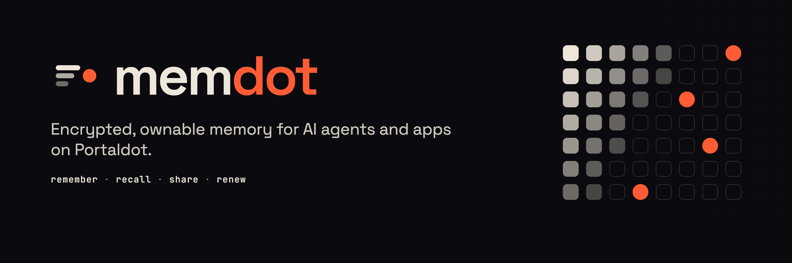
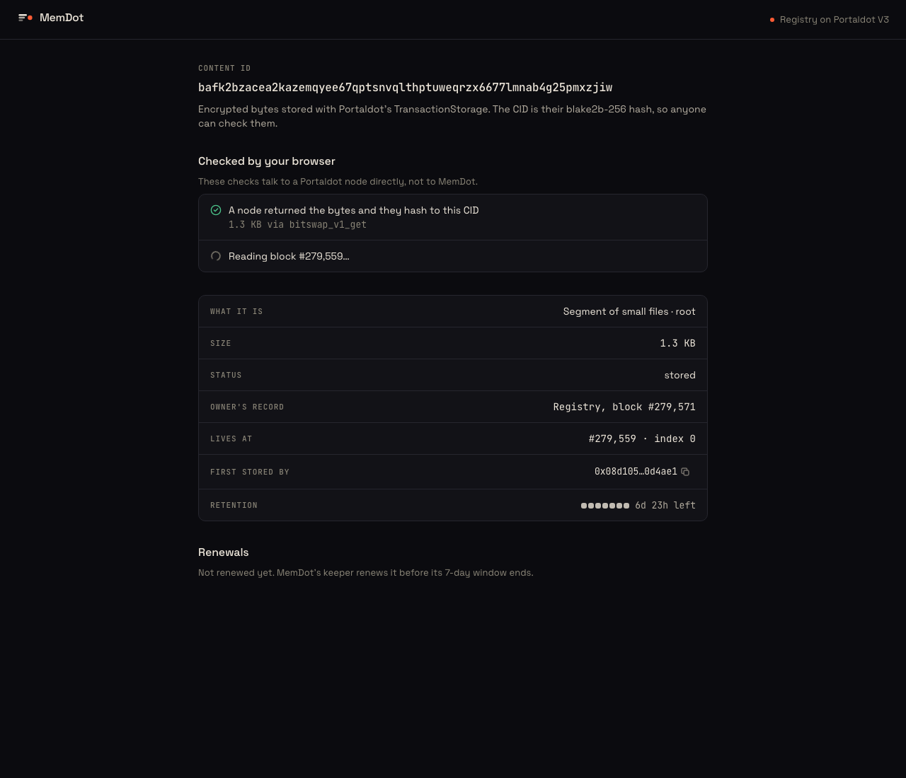
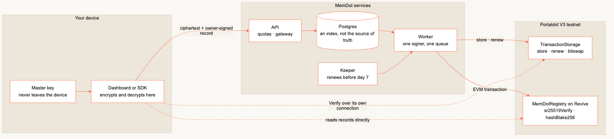
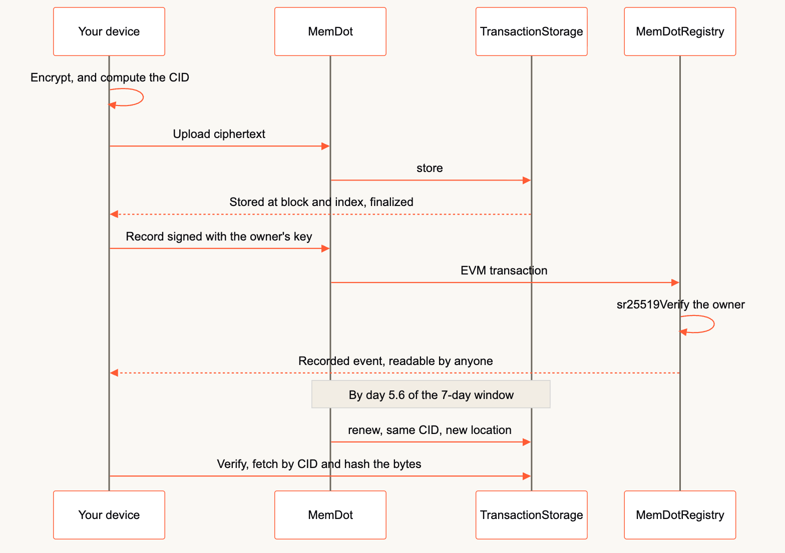

<p align="center">
  <a href="https://app.84.46.247.92.sslip.io">
    
  </a>
</p>

<h1 align="center">MemDot</h1>
<p align="center">Encrypted storage on Portaldot that keeps itself alive.<br/>Sealed on your device, stored with V3 TransactionStorage, renewed before its 7-day window ends, and shared on your terms.</p>

<p align="center">
  <a href="https://app.84.46.247.92.sslip.io"><b>Open the app</b></a>
  &nbsp;·&nbsp;
  <a href="#see-it-live"><b>See it live</b></a>
  &nbsp;·&nbsp;
  <a href="https://app.84.46.247.92.sslip.io/proof/registry"><b>On-chain registry</b></a>
  &nbsp;·&nbsp;
  <a href="https://api.84.46.247.92.sslip.io/docs"><b>API reference</b></a>
</p>

MemDot is a storage layer for Portaldot V3: a dashboard, a TypeScript SDK and a REST API that put files and app data on `TransactionStorage`, encrypted before they leave your device, and record who owns and may read them in a Solidity registry on `Revive`. A keeper renews everything before the chain's 7-day retention ends, so developers get storage that behaves like storage. Agent memory runs on the same layer: an agent remembers and recalls by meaning, and each memory is an encrypted entry on the chain, read either on your device or by a server you've chosen to trust with it.

Built for the [Portaldot Hacker House 2026](https://dorahacks.io/hackathon/portaldot-hacker-house-2026/detail) · Modular Cloud & Middleware. Jump to [how MemDot meets the hackathon](#how-memdot-meets-the-hackathon).

## The problem

Someone building on Portaldot needs to keep data: a user's documents, an app's state, what an agent learned yesterday. Today they have two options.

They can put it in a cloud bucket or their own database. Then the user can't take it elsewhere, can't prove what was stored, and has to trust the operator not to read it. The app is on-chain, but its data isn't.

Or they can use V3's `TransactionStorage`, which does hold bytes on-chain, and take on everything it leaves out:

1. **It's public.** Whatever you store, anyone can fetch by its hash.
2. **It expires.** Bytes are kept for 100,800 blocks, which is 7 days. After that they're gone unless someone has called `renew`.
3. **Renewing is bookkeeping.** `renew` needs the exact block and index where the item lives now, and every renewal moves it, so you need a process that tracks each item and never misses a week.
4. **It knows nothing about ownership.** There's no owner, folder, name or permission, and a contract can't read the bytes.
5. **It can't be wrapped.** `store` and `renew` must be top-level extrinsics, so an EVM wallet or a contract can't call them on a user's behalf.

So nobody ships on it. The chain has a storage primitive, and developers still have nowhere to keep private data that they own and that lasts.

## The idea

You sign in with a passkey or a Portaldot wallet, drop in a file, and your job ends there. MemDot encrypts it on your device with a key only you hold, stores the ciphertext on V3, shows you the block it landed in, renews it for you, and lets you share it with one address and take that back.

**One journey, with real values.** On live V3, the seed script behind this repo's evidence did what a new user does:

- It created an account. The master key and a 12-word recovery code were made on the device; MemDot's servers received neither.
- It stored three small files, a note, an agent's JSON and an SVG, packed together as one encrypted segment, so they cost one transaction and renew as one.
- It stored a 115 KB image as a chunk plus a sealed manifest.
- It renewed the segment: same CID, new location.
- It shared the space with a second account, which opened the note on its own device.
- It verified everything over its own connection to a Portaldot node, fetching each blob by CID and hashing the bytes, without asking MemDot.
- Each step above was recorded in `MemDotRegistry`, signed by the owner's key.

Every transaction is linked under [Proof](#proof).

**Who can see what.**

| | Anyone on-chain | MemDot's servers | Someone you shared with | You |
|---|---|---|---|---|
| File contents and names | Ciphertext | Ciphertext | Readable | Readable |
| Your master key | Never | Never | Never | On your device only |
| Each blob's CID and padded size | Public | Yes | Yes | Yes |
| Who owns a space, and who it's shared with | Public, as signed records | Yes | Yes | Yes |
| A **Private** namespace's memories | Ciphertext | Ciphertext and ids | Readable | Readable |
| An **Assisted** namespace's memories | Ciphertext | Reads the text to extract and search; stores it only sealed, with keywords as keyed hashes | Through MemDot | Readable, with or without MemDot |
| An Assisted memory's search vector | Never | Yes. A vector can approximate the text it came from | No | Through MemDot |
| An Assisted memory's user, agent and run ids, metadata and categories, and its namespace's instructions | Ciphertext | Yes, so they can be filtered and used | Through MemDot | Yes |

Revoking a share stops future access: the space moves to a new key epoch for new writes. What someone already decrypted can't be taken back, and MemDot says so in the dialog.

## See it live

<p align="center">
  <a href="https://app.84.46.247.92.sslip.io/proof/cid/bafk2bzacea2kazemqyee67qptsnvqlthptuweqrzx6677lmnab4g25pmxzjiw">
    
  </a>
</p>
<p align="center"><i>A stored object's public proof page. Your browser runs the checks, not MemDot.</i></p>

1. Open [the app](https://app.84.46.247.92.sslip.io) and create an account with a passkey or wallet. Setup walks through the recovery code, a first space, an API key and a first file.
2. Upload something small. The upload sheet shows the fee and who pays before you confirm, and the tray follows it to finalized.
3. Open the file and press **Verify**. Your browser fetches the bytes from a Portaldot node and hashes them.
4. Open [the registry](https://app.84.46.247.92.sslip.io/proof/registry). Your space and file appear there as records signed by your key, read from Portaldot's EVM RPC by your browser.

## How it works

<p align="center">
  <picture>
    <source media="(prefers-color-scheme: dark)" srcset=".github/assets/system-dark.png" />
    <source media="(prefers-color-scheme: light)" srcset=".github/assets/system-light.png" />
    
  </picture>
</p>
<p align="center"><a href=".github/diagrams/readme-system.mmd">Edit the Mermaid source</a></p>

<p align="center">
  <picture>
    <source media="(prefers-color-scheme: dark)" srcset=".github/assets/store-flow-dark.png" />
    <source media="(prefers-color-scheme: light)" srcset=".github/assets/store-flow-light.png" />
    
  </picture>
</p>
<p align="center"><a href=".github/diagrams/readme-store-flow.mmd">Edit the Mermaid source</a></p>

Choices that came from measuring V3, not from preference:

- **The registry keeps no state.** Revive holds about 0.08 tPOT per byte of code and about 4 tPOT per stored word, while a log costs only the call's fee. So [`MemDotRegistry`](packages/contracts/src/MemDotRegistry.sol) checks an sr25519 signature and emits one event per record. That took the deploy from 473 to 118 tPOT and makes a record cheap enough to write for every object. Ownership still holds: a space id is `hashBlake256(owner, salt)`, so nobody can record into someone else's space.
- **One signer, one queue.** Every relayer extrinsic goes through one pg-boss queue, so nonces never collide, and renewals outrank stores because a missed renewal loses data while a late store only waits.
- **The keyword index can't be read back.** Assisted search ranks with BM25 over keyed hashes of each word, so the server finds words without keeping them. Every memory also lives in an encrypted segment on V3, so Restore can wipe the index and derive it again from the chain alone.
- **Small files share a segment.** Storing costs about 105 tPOT per MiB plus 0.012 per transaction, and each item needs its own renewal, so files under 64 KiB uploaded together go into one encrypted blob.
- **Reads don't depend on us.** Verify and the proof pages talk to a Portaldot node from your browser.

### Built on Portaldot V3

| Piece | What MemDot does with it | Where |
|---|---|---|
| `TransactionStorage.store` | Holds every encrypted blob, as a top-level extrinsic | [`packages/chain/src/storage.ts`](packages/chain/src/storage.ts) |
| `TransactionStorage.renew` | The keeper moves each item forward before day 7 | [`apps/worker/src/handlers/keeper.ts`](apps/worker/src/handlers/keeper.ts) |
| `bitswap_v1_get` | Reads bytes by CID, checked against the hash | [`packages/chain/src/bitswap.ts`](packages/chain/src/bitswap.ts) |
| `Revive` EVM | Runs the Solidity registry; records are real EVM transactions, so any Ethereum tool can read them | [`packages/contracts/src/MemDotRegistry.sol`](packages/contracts/src/MemDotRegistry.sol) |
| System precompile: `sr25519Verify` | Checks the owner's signature on every record | same contract |
| System precompile: `hashBlake256` | Derives space ids from their owner | same contract |
| EVM RPC logs | The indexer and the browser read records | [`apps/web/lib/registry.ts`](apps/web/lib/registry.ts) |
| Portaldot Extension, Talisman, SubWallet, polkadot.js | Sign-in, self-signed stores, and `signVrf` unlock | [`packages/sdk/src/browser-wallet.ts`](packages/sdk/src/browser-wallet.ts) |

## How MemDot meets the hackathon

Track: **Modular Cloud & Middleware**, "focusing on decentralized middleware, storage/data components, and APIs", to "enrich Portaldot's Web3 Cloud developer toolkit".

| Criterion | How MemDot meets it | Check it |
|---|---|---|
| **Technical Feasibility (30%)**: "whether core functions are completed, whether GitHub shows genuine and sustained development activity, and whether the project is deployed on Portaldot testnet with verifiable on-chain interactions" | The store, share, renew and verify loop runs live on V3, deployed with its own contract | [Proof](#proof), [the live app](https://app.84.46.247.92.sslip.io), [commit history](https://github.com/Blockchain-Oracle/memdot/commits/main) |
| **Innovation (30%)**: "effective use of Portaldot V3.0 features such as WASM/EVM compatibility, modular architecture, and multi-chain capabilities, and whether the project delivers real value beyond existing solutions" | Native `TransactionStorage` plus an EVM contract that verifies Substrate signatures through precompiles, with client-side encryption and automatic renewal on top | [`MemDotRegistry.sol`](packages/contracts/src/MemDotRegistry.sol), [who sees what](#the-idea) |
| **Ecosystem Contribution (20%)**: "Portaldot infrastructure, developer tools… open-source value" | An Apache-2.0 SDK, REST API and dashboard that any Portaldot app can use, plus a public registry anyone can read | [`packages/sdk`](packages/sdk), [API reference](https://api.84.46.247.92.sslip.io/docs) |
| **Business Potential (20%)**: "real market needs… target users and use cases" | For app developers who need private user data on-chain and agent builders whose agents forget between sessions. Sponsored quotas let them start without tokens; self-signed spaces let users pay their own way | [Plans & usage](https://app.84.46.247.92.sslip.io/usage) |

## Proof

`MemDotRegistry` on Portaldot V3 testnet (chain ID 420420777): `0x24ee3a18c64954d979b7475ccdf58ce4750fb5d1`. The contract's records are public at [`/proof/registry`](https://app.84.46.247.92.sslip.io/proof/registry).

<!-- evidence:start -->
| What happened | Transaction | Block | Check it |
|---|---|---|---|
| Registry deployed | `0xa5361222…f890d6` | [#279,265](https://app.84.46.247.92.sslip.io/proof/block/279265) | `0x24ee3a18c64954d979b7475ccdf58ce4750fb5d1` |
| Three files stored in one segment | [`0x08d10550…0d4ae1`](https://app.84.46.247.92.sslip.io/proof/tx/0x08d105506d8c43c51c82184bdcc66047c2eb2c984c51a93c742ee853870d4ae1) | [#279,559](https://app.84.46.247.92.sslip.io/proof/block/279559) | [`bafk2bzacea2…mxzjiw`](https://app.84.46.247.92.sslip.io/proof/cid/bafk2bzacea2kazemqyee67qptsnvqlthptuweqrzx6677lmnab4g25pmxzjiw) |
| Larger file stored (chunk + sealed manifest) | [`0xf2db5b24…658b3a`](https://app.84.46.247.92.sslip.io/proof/tx/0xf2db5b24b71a9a249820b72095c368d5937387e8574dc049a7287dd01d658b3a) | [#279,566](https://app.84.46.247.92.sslip.io/proof/block/279566) | [`bafk2bzacedl…yafdh2`](https://app.84.46.247.92.sslip.io/proof/cid/bafk2bzacedlazejtcpok7yfl56xwbdxf47f4fepjnxqmsynowekw3zryafdh2) |
| Segment renewed: same CID, moved from block 279,559 | [`0x1955b32e…0da189`](https://app.84.46.247.92.sslip.io/proof/tx/0x1955b32e13e157f8bbf7f5a27f4edbeae0990cef85d23bd041009db7810da189) | [#280,474](https://app.84.46.247.92.sslip.io/proof/block/280474) | [`bafk2bzacea2…mxzjiw`](https://app.84.46.247.92.sslip.io/proof/cid/bafk2bzacea2kazemqyee67qptsnvqlthptuweqrzx6677lmnab4g25pmxzjiw) |
| File signed and paid for by the user's own wallet | [`0x393269a9…36c692`](https://app.84.46.247.92.sslip.io/proof/tx/0x393269a9787060df0c4f7c96957141a6819793ca626caac15d8c9cb1d236c692) | [#282,189](https://app.84.46.247.92.sslip.io/proof/block/282189) | [`bafk2bzacebi…ju34cq`](https://app.84.46.247.92.sslip.io/proof/cid/bafk2bzacebi7eouao3n4sf7rx5vu4wf2zyquhkkgrcqr42zvjehgr3wju34cq) |
| Larger file signed and paid for by the same wallet | [`0xbf696ed3…782d00`](https://app.84.46.247.92.sslip.io/proof/tx/0xbf696ed31fc441dc49ccf94c0ba382d5f35c7f9390b15a944e88720827782d00) | [#282,199](https://app.84.46.247.92.sslip.io/proof/block/282199) | [`bafk2bzacedt…bxrw3s`](https://app.84.46.247.92.sslip.io/proof/cid/bafk2bzacedtritbfcnyykkoupnzvejiculbwa7mfqcyf5s5iiqbmtktbxrw3s) |
| An agent memory stored as an encrypted segment, written by MemDot's server | [`0xb079c463…16e440`](https://app.84.46.247.92.sslip.io/proof/tx/0xb079c4637544dbf0239e67c78c62f4c16229aa509a799871533dc3eee616e440) | [#290,108](https://app.84.46.247.92.sslip.io/proof/block/290108) | [`bafk2bzacebd…f3ammk`](https://app.84.46.247.92.sslip.io/proof/cid/bafk2bzacebdu6pyrawfod3xzdpupki6tnsu6esu7psli65bsnqu3c5ff3ammk) |
| A Private namespace's search index, sealed on the device | [`0xd2ad4b7a…90b40f`](https://app.84.46.247.92.sslip.io/proof/tx/0xd2ad4b7a1f6d951a11bf1173f6f1dffedb358ce960352ab7884a3bd0df90b40f) | [#290,146](https://app.84.46.247.92.sslip.io/proof/block/290146) | [`bafk2bzaceby…i65jze`](https://app.84.46.247.92.sslip.io/proof/cid/bafk2bzaceby2izysafw5swfnfgrst2lcyekrylhlcb5qc23lorzjsxri65jze) |
| Facts a model distilled from a conversation, sealed and stored by the live service | [`0xb963441b…0d1f99`](https://app.84.46.247.92.sslip.io/proof/tx/0xb963441be4733ef5925db6d90c295585199d4d494faacccd7a62623d160d1f99) | [#292,294](https://app.84.46.247.92.sslip.io/proof/block/292294) | [`bafk2bzaceac…5b4xty`](https://app.84.46.247.92.sslip.io/proof/cid/bafk2bzaceacyzape23nfdzyqypvol4mnvmep2c3t43cukovdwpw5t245b4xty) |
| Registry record: Space created | `0x43dc7871…a86cf0` | [#279,570](https://app.84.46.247.92.sslip.io/proof/block/279570) | [view](https://app.84.46.247.92.sslip.io/proof/registry) |
| Registry record: Object recorded | `0x9cd18679…867ed8` | [#279,571](https://app.84.46.247.92.sslip.io/proof/block/279571) | [view](https://app.84.46.247.92.sslip.io/proof/registry) |
| Registry record: Object recorded | `0x7c18bd1c…0387b7` | [#279,572](https://app.84.46.247.92.sslip.io/proof/block/279572) | [view](https://app.84.46.247.92.sslip.io/proof/registry) |
| Registry record: Space shared | `0x52e8b74d…87d9c5` | [#279,580](https://app.84.46.247.92.sslip.io/proof/block/279580) | [view](https://app.84.46.247.92.sslip.io/proof/registry) |

Recorded by [`docs/evidence/s07-seed-2026-11-01.json`](docs/evidence/s07-seed-2026-11-01.json), [`docs/evidence/s07-self-signed-2026-11-01.json`](docs/evidence/s07-self-signed-2026-11-01.json), [`docs/evidence/s08-seed-2026-11-02.json`](docs/evidence/s08-seed-2026-11-02.json) and [`docs/evidence/s08-live-2026-11-02.json`](docs/evidence/s08-live-2026-11-02.json). Registry transaction hashes are the EVM hashes Revive's RPC reports.
<!-- evidence:end -->

Earlier runs are in [`docs/evidence/`](docs/evidence): the first store and renew round trip, the service walk and the SDK journey.

## What's in the product today

- **Dashboard:** passkey and wallet sign-in, recovery codes, spaces paid for by MemDot or by your own wallet, files with preview, versions, Verify and Renew now, sharing and revoking, API keys with roles, activity, renewals, usage, settings, and a command palette, on desktop and phone, in light and dark.
- **Agent memory:** namespaces in two modes. Private extracts, embeds and searches on your device, with your own model key if you want extraction at all. Assisted does it on the server, for agents that only hold an API key. Both offer remember (distilled by a model or stored as written, with pictures and documents in Assisted), search by meaning and keywords with filters that nest AND, OR and NOT, update with history, forget, users, agents and runs, custom instructions and categories, restore from the chain, and importing another memory product's export. A file in a memory folder teaches its namespace, and deleting the file forgets what it taught.
- **Data:** export everything as a decrypted zip and bring it into a new account, or delete the account, which stops every renewal.
- **TypeScript SDK:** [`packages/sdk`](packages/sdk) covers accounts, spaces, folders, files, sharing, jobs, memories in both modes, export and import, and self-signed stores with a wallet.
- **REST API:** OpenAPI 3.1 and a [reference](https://api.84.46.247.92.sslip.io/docs), with API keys and per-key rate limits, plus `/v1/chat/completions`: point any OpenAI client at it, and each call recalls what's relevant and remembers the exchange.
- **Service:** relayer and keeper on one signer queue, a chain indexer, a CID gateway with a ciphertext cache, a low-balance breaker that pauses stores and never renewals, and alerts.
- **Public proof pages:** one for each [CID, transaction and block](https://app.84.46.247.92.sslip.io/proof/registry), plus the registry.

## Run it locally

```bash
pnpm install
docker compose -f deploy/compose.dev.yml up -d
cp .env.example .env              # then fill in the secret and a funded testnet mnemonic
pnpm --filter @memdot/chain keygen # prints a fresh relayer account to fund
pnpm dev                          # web on :3100, API on :8787, worker
```

Production images: [`apps/api/Dockerfile`](apps/api/Dockerfile), [`apps/worker/Dockerfile`](apps/worker/Dockerfile) and [`apps/web/Dockerfile`](apps/web/Dockerfile), all built from the repo root.

## Repository layout

| Path | What it is |
|---|---|
| [`apps/web`](apps/web) | Next.js dashboard and public proof pages |
| [`apps/api`](apps/api) | Hono REST API, auth and the CID gateway |
| [`apps/worker`](apps/worker) | Relayer queue, keeper, indexer and alerts |
| [`packages/sdk`](packages/sdk) | The TypeScript SDK |
| [`packages/crypto`](packages/crypto) | Keys, key bundle, encryption, manifests and segments |
| [`packages/chain`](packages/chain) | Portaldot V3 client: store, renew, read and contract calls |
| [`packages/contracts`](packages/contracts) | `MemDotRegistry`, its tests and deployment record |
| [`packages/memory-engine`](packages/memory-engine) | Extraction, ranking, filters and the on-device index, used by both modes |
| [`packages/memory-server`](packages/memory-server) | Assisted memory's keys, index and how memories reach the chain |
| [`packages/db`](packages/db), [`packages/jobs`](packages/jobs), [`packages/config`](packages/config), [`packages/ui`](packages/ui) | Schema, queue, constants, and the design system |

## Honest limits

- **Testnet only.** Everything here runs on Portaldot V3 testnet, and the app is on a temporary address until its own domain is live. Accounts made on this address will need their recovery code after the move, because passkeys are tied to a domain.
- **Sponsored storage is small.** The relayer pays about 105 tPOT per MiB from a testnet budget of a few hundred tPOT, so a sponsored space holds 128 KiB, up to 5 spaces per account. Stores pause if the relayer runs low; renewals keep going. A space can move to your own wallet at any point: it then has no quota, and the wallet pays for each store.
- **Real extensions still being walked.** Wallet sign-in, MetaMask sign-in and wallet-paid stores ran in the dashboard on a local build against live V3, using test wallets that sign the way an extension does. Touch ID passkey unlock and Talisman or SubWallet unlock need a real authenticator and extension, and haven't been walked on the live site yet. The recovery code works everywhere.
- **Not built yet:** the CLI, the MCP server, the Python SDK, agent plugins and the docs site. They're next in the build order, on the layer described here.
- **The live service's shared model is on a free tier.** Each account gets 10 model calls and 100 embedded searches a day on it, and every account shares the key's daily quota. When it runs out, new memories are stored as written and search falls back to keywords. An account's own key, set under Configuration, has no limit.
- **Assisted means trusting the server with the text.** It reads what you send, and it can open what it stored: its keys derive from one secret in the service's environment. The database alone opens nothing, and you can read every Assisted memory without MemDot, but use Private for anything MemDot shouldn't see.
- **Forgetting is immediate in search, slower on chain.** A forgotten memory leaves search and lists at once. Its encrypted entry stays in its segment until the segment is rewritten or expires, and anything already read can't be recalled.
- **A memory can be poisoned.** Extraction ignores instructions planted in a conversation, and recalled text is marked as data for whatever model reads it next, but a model can still be fooled. Treat memories as notes, not commands.
- **Rebuilding from the chain is partial.** Stored items and renewals rebuild from chain events. Rebuilding spaces and objects from registry records is not written yet, though the records are on-chain.
- **A record follows its upload.** Registry records are submitted after the store they describe and never block it, so one can lag or, if the relayer fails, be missing. Stored bytes are unaffected.
- **Content checks happen in the client.** A contract can't read `TransactionStorage`, so the registry vouches for who signed a record, not for the bytes. Verify checks the bytes.
- **Not yet audited,** and the keeper runs on one server.

## Licence

[Apache-2.0](LICENSE).
