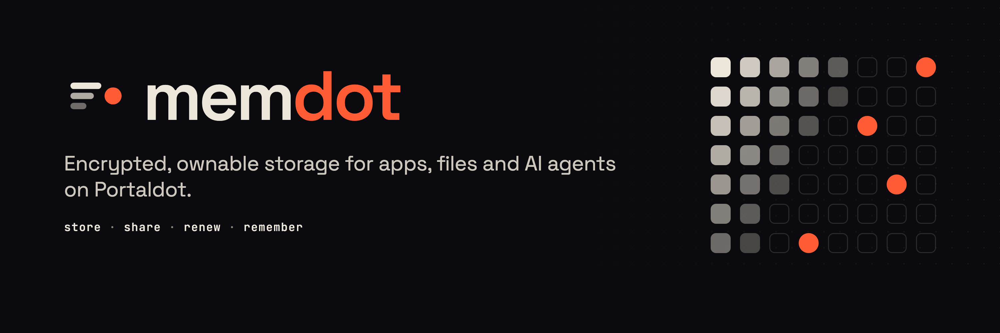
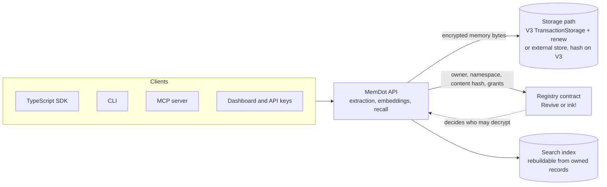

<p align="center"></p>

# MemDot

Decentralized storage on Portaldot V3 for apps, files and AI-agent memory.

> **Status — 2026-10-29, early build.** Research and a live-runtime probe are done. The storage architecture is still being decided; the open questions are in [docs/office-hours.md](docs/office-hours.md). Nothing is deployed to the testnet yet, and this README will say so until it is.

## Why

Portaldot apps and agents need somewhere to keep data they own. Today that means a cloud bucket or an operator's database: the user cannot take the data elsewhere, cannot prove what was stored, and has to trust the operator not to read it. AI agents have the sharpest version of this problem, because they forget between sessions unless someone else holds their memory.

MemDot is a storage layer on V3. Files and app data are encrypted before they leave the client, stored and renewed on-chain, and their ownership and access grants live in an on-chain registry. Agent memory (remember and recall) is built on the same layer. Developers reach it through one SDK, a REST API, a CLI, an MCP server for agents, and a dashboard with API keys.

The core loop is **store → share → renew**, with **remember → recall** on top for agents.

## What V3 actually offers (measured)

Read from the live testnet on 2026-10-29 with [`scripts/v3-probe.mjs`](scripts/v3-probe.mjs). Full output: [docs/evidence/v3-probe-2026-10-29.json](docs/evidence/v3-probe-2026-10-29.json).

| Pallet | Calls we care about | Limits and constants |
|---|---|---|
| `TransactionStorage` | `store`, `renew`, `check_proof` | 8 MiB per transaction, 512 per block, `byteFee` 10, `entryFee` 1,000, `retentionPeriod` **100,800 blocks = 7 days** at 6 s blocks |
| `Revive` (EVM) | `eth_transact`, `instantiate_with_code`, `map_account` | chain ID 420420777, EVM bytecode allowed, `AutoMap` on, native-to-ETH ratio 10,000 |
| `Contracts` (WASM/ink!) | `instantiate_with_code`, `call` | API version 4, max code 125,952 bytes |

Runtime `portaldot-v3` spec 3002, 69 pallets, 6,000 ms blocks.

The 7-day retention is the fact that shapes the design: anything stored natively must be renewed, or it disappears.

## Candidate architecture (not final)



Decisions still open, each blocked on a question in [docs/office-hours.md](docs/office-hours.md):

1. **Where the bytes live.** Native `TransactionStorage` with a renewal keeper, or an external store with only the content hash and grants on V3. This depends on whether the hosted node serves stored bytes back.
2. **Where plaintext exists.** Memory extraction needs an LLM to read the text. Either the API sees plaintext briefly, or extraction runs client-side.
3. **Which contract runtime** holds the registry: Solidity on `Revive`, or ink! on `Contracts`.

## Repository today

| Path | What it is |
|---|---|
| [`scripts/v3-probe.mjs`](scripts/v3-probe.mjs) | Read-only probe of V3 runtime metadata (pallet calls, constants, storage values) |
| [`docs/evidence/`](docs/evidence) | Dated probe output, so every number above can be checked |
| [`docs/office-hours.md`](docs/office-hours.md) | Progress report and questions for the Portaldot mentors |
| [`assets/brand/`](assets/brand) | Logo mark (SVG) and banner source |

```bash
pnpm install
pnpm probe                      # defaults to wss://test-node-v3.portaldot.dev
```

## Next, before the check-in on 2026-11-04 04:00 UTC

1. Fund a testnet account and run a signed `store` → read back → `renew` round trip; record the transaction hashes.
2. Settle the three open decisions above.
3. Deploy the registry contract and wire remember and recall end to end through the SDK.
4. A demo of the first flow and an architecture diagram that matches what is deployed.

Built for the [Portaldot Hacker House 2026](https://dorahacks.io/hackathon/portaldot-hacker-house-2026/detail), Modular Cloud & Middleware track.
